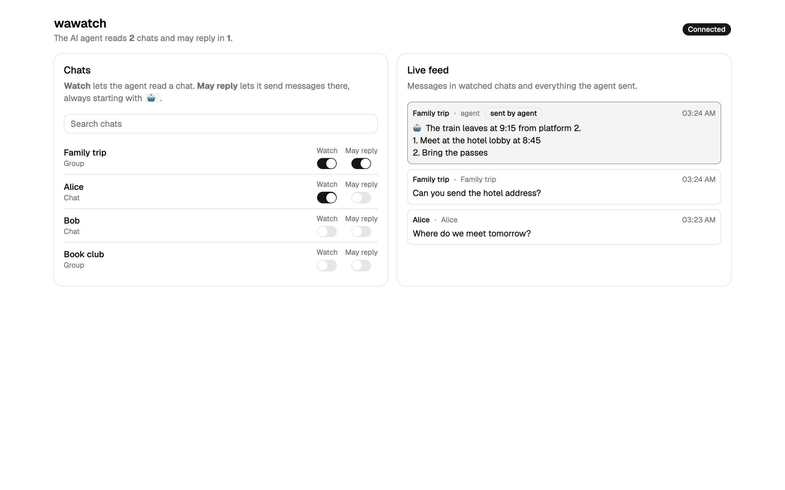
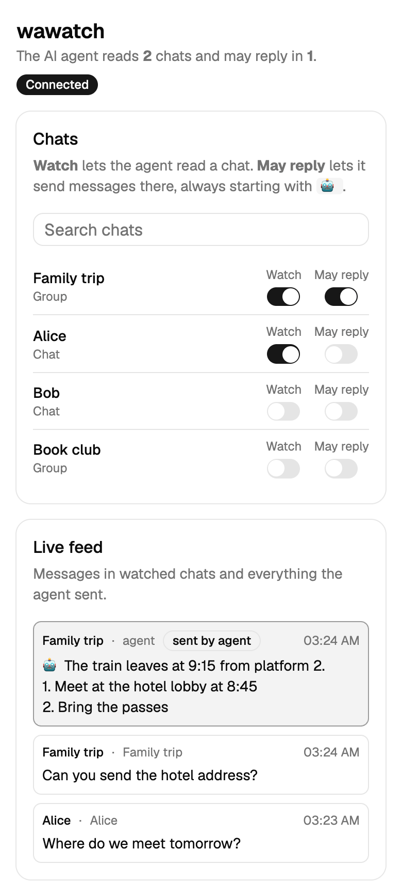

# wawatch

Let Claude, or any AI agent, watch your WhatsApp chats and answer them. You stay in control in a small web UI.

- **For agents:** an [MCP](https://modelcontextprotocol.io) server (Claude Code, Claude Desktop, any MCP client), a webhook, and a plain HTTP API.
- **For you:** a local web page that shows which chats the agent reads, where it may reply, and a live feed of every message it sees and sends.

| Desktop | Mobile |
| --- | --- |
|  |  |

> [!WARNING]
> **Unofficial. Use at your own risk.** wawatch is not affiliated with WhatsApp or Meta. It connects as a *linked device* through the third-party library [Baileys](https://github.com/WhiskeySockets/Baileys), which speaks WhatsApp's linked-device protocol. Automated use of a personal account **may violate the [WhatsApp Terms of Service](https://www.whatsapp.com/legal/terms-of-service)**, and **WhatsApp can ban accounts** that it thinks are automated. Use it only with your own account, only in chats where people know an AI may answer, and keep the volume low.

## Why

Without this, an agent that watches WhatsApp has to drive WhatsApp Web in a browser: poll the page on a timer, scrape DOM selectors that break, click "load older messages", fight auto-formatting of multi-line text, and the user cannot see what the agent is watching. wawatch replaces that with:

- **Events, not polling.** `wait_for_message` blocks until a message arrives (long-poll), so an agent loop needs no cron.
- **No browser, no DOM.** Messages come from the protocol through Baileys.
- **Text sent as-is.** Multi-line text and lists arrive exactly as the agent wrote them.
- **A signature on every reply.** A configurable prefix (default `🤖 `) tells people the message came from an AI.
- **Visible permissions.** The UI lists every chat with two switches: *Watch* and *May reply*.

## Safety by default

- Listens on `127.0.0.1` only. Host-header checks block DNS rebinding. Writes need `Content-Type: application/json` and no foreign `Origin`, so web pages you visit cannot drive it.
- The agent reads **only watched chats**. It can ask to watch a chat (`watch_chat`), and you see that in the UI at once.
- The agent sends **only to chats where you turned on *May reply***. Only the UI (or the local HTTP API) can turn it on, not an MCP tool.
- Every agent message is logged, marked "sent by agent" in the live feed, and starts with the signature.
- On disk (`~/.wawatch`): the WhatsApp session keys (`auth/`), your permissions (`settings.json`), and messages from watched chats plus agent messages (`messages.jsonl`). Messages from other chats stay in memory only. Treat `auth/` like a password: anyone with it can use your WhatsApp.

## Quick start

Needs Node.js 20.19 or later.

```sh
git clone https://github.com/tupe12334/wawatch.git
cd wawatch
npm ci
npm run build
node dist/cli.js
```

1. Open <http://127.0.0.1:4747>.
2. On your phone: WhatsApp → Settings → Linked devices → Link a device. Scan the QR code from the page (it also prints in the terminal).
3. Turn on *Watch* for the chats the agent may read, and *May reply* where it may answer.

To try the UI and tools without WhatsApp, run `node dist/cli.js --demo` (fake chats, nothing is sent).

### Options

| Flag | Env | Default |
| --- | --- | --- |
| `--port` | `WAWATCH_PORT` | `4747` |
| `--data` | `WAWATCH_DATA` | `~/.wawatch` |
| `--signature` | `WAWATCH_SIGNATURE` | `🤖 ` |
| `--webhook` | `WAWATCH_WEBHOOK_URL` | off |
| | `WAWATCH_WEBHOOK_SECRET` | off |
| `--demo` | | off |

Example signature: `--signature "🤖 Claude (Ofek's assistant): "`.

To pair again, stop wawatch and delete `~/.wawatch/auth`.

## Use with Claude Code (MCP)

wawatch serves MCP over Streamable HTTP at `http://127.0.0.1:4747/mcp`.

```sh
claude mcp add --transport http wawatch http://127.0.0.1:4747/mcp
```

Other MCP clients take the same URL, for example:

```json
{ "mcpServers": { "wawatch": { "type": "http", "url": "http://127.0.0.1:4747/mcp" } } }
```

Then ask Claude something like: *"Watch the 'Family trip' chat. Wait for messages and answer questions about the trip."*

### Tools

| Tool | What it does |
| --- | --- |
| `status` | Link status, signature, current cursor. |
| `list_chats` | Chats with `watched` / `may_reply` flags. Optional `query`, `watched_only`, `limit`. |
| `watch_chat` / `unwatch_chat` | Start or stop reading a chat. Unwatch also removes *May reply*. |
| `read_messages` | Messages from watched chats. No `since`: the latest. With `since`: messages after that cursor. Optional `chat_id`, `limit`. |
| `wait_for_message` | Blocks until a new message arrives in a watched chat (default 60 s, max 600 s). Returns `[]` on timeout. |
| `send_message` | Sends `text` to `chat_id` if *May reply* is on. Adds the signature. |

Every read returns a `cursor`. Pass it back as `since` so no message is lost between calls. A simple agent loop:

```
cursor = status().cursor
loop:
  r = wait_for_message(since=cursor, timeout_seconds=300)
  cursor = r.cursor
  for m in r.messages: decide, then send_message(m.chat_id, answer)
```

If your client stops long tool calls early, use a shorter `timeout_seconds` (Claude Code reads the `MCP_TOOL_TIMEOUT` env var, in ms).

## Use with any other agent (webhook + HTTP)

Start with a webhook URL:

```sh
WAWATCH_WEBHOOK_SECRET=change-me node dist/cli.js --webhook http://127.0.0.1:8000/whatsapp
```

For each new live message in a watched chat, wawatch sends:

```http
POST /whatsapp
Content-Type: application/json
X-Wawatch-Signature: sha256=<HMAC-SHA256 of the body with WAWATCH_WEBHOOK_SECRET>

{"event":"message","message":{"cursor":12,"chat_id":"...@g.us","chat":"Family trip","from":"Dana","text":"When is the train?","time":"2026-10-25T08:00:00.000Z"}}
```

Reply, and read history, over HTTP:

```sh
curl -X POST http://127.0.0.1:4747/api/send \
  -H 'Content-Type: application/json' \
  -d '{"chat_id":"...@g.us","text":"The train leaves at 9:15."}'

curl 'http://127.0.0.1:4747/api/messages?since=12&chat_id=...@g.us'
```

The same rules apply: reads cover watched chats only, and sends need *May reply*.

## Why Baileys

Two maintained libraries implement WhatsApp's linked-device protocol in Node.js:

- **[Baileys](https://github.com/WhiskeySockets/Baileys)** talks to WhatsApp over a WebSocket. No browser. It pushes events for new messages and history sync, and it is written in TypeScript.
- **[whatsapp-web.js](https://github.com/pedroslopez/whatsapp-web.js)** runs WhatsApp Web in headless Chromium through Puppeteer.

wawatch uses Baileys. It is lighter (no Chromium download or process), and it does not depend on the WhatsApp Web page, which is the thing that breaks browser automation. The cost: Baileys must follow protocol changes, so keep it up to date (`npm update baileys`).

## How it works

```
WhatsApp ⇄ Baileys (src/baileys.ts) ⇄ Hub (src/hub.ts: permissions, log, cursor)
                                        ├─ MCP tools  (src/mcp.ts)  → /mcp
                                        ├─ HTTP API + SSE + webhook (src/server.ts)
                                        └─ Web UI (web/, React + shadcn/ui)
```

## Development

```sh
npm ci
npm run demo        # API + MCP with fake chats on :4747
npx vite            # UI dev server (proxies /api to :4747)
npm test
npm run typecheck
```

Tests use a mock transport. They never connect to WhatsApp.

## License

[MIT](LICENSE)
